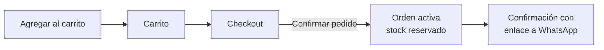
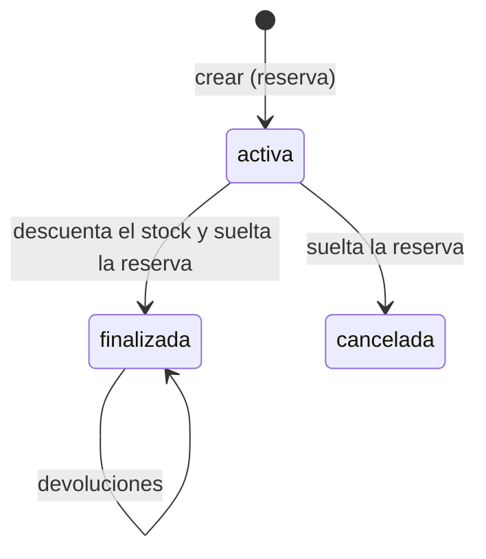

# Funcionamiento

Los recorridos importantes de AnaVende, paso a paso, con el archivo donde
vive cada uno. Para ver cómo están armadas las piezas que usan, leé
[Arquitectura](ARQUITECTURA.md). Las reglas completas están en la
[especificación funcional](../sdd/mvp/FUNCTIONAL-SPEC.md) (RF y RN) y en la
[técnica](../sdd/mvp/TECHNICAL-SPEC.md) (TS).

## La idea de fondo

La web no cobra. Arma el pedido, aparta el stock y termina en una
conversación de WhatsApp con Ana, que ya trae el producto, el color, la
cantidad y el precio. El pago y la entrega se arreglan en esa conversación,
fuera del sistema. Lo que el sistema garantiza es que **el stock diga la
verdad**, incluidas las ventas que no pasaron por la web.

## Mirar y consultar, sin cuenta

Un visitante navega todo: la home, el catálogo con filtros y búsqueda, las
categorías y la ficha de cada producto.

- **El catálogo** (`/productos`) guarda todo su estado en la dirección:
  filtros, orden y página. El botón atrás funciona, y el enlace se puede
  mandar por WhatsApp tal como se está viendo (`modules/catalog/products/tienda.ts`).
- **La ficha** (`/productos/[slug]`) cambia de foto, stock y mensaje al
  elegir otro color, sin recargar. El slug no cambia al renombrar un
  producto, para no romper los enlaces ya compartidos.
- **«Consultar por WhatsApp»** arma un enlace `wa.me` con el producto, el
  color y la cantidad que se están mirando (`lib/whatsapp.ts`). Es la forma
  de comprar sin cuenta.
- **Los recomendados** de la ficha y del carrito los calcula el servidor
  (`modules/catalog/products/recomendados.ts`) y llegan después que el resto
  de la página, para no demorarla. «Vistos recientemente» lo anota el
  navegador en una cookie.

Un visitante **no arma carrito**: el carrito es de las cuentas.

## Comprar

1. **Agregar al carrito.** Si quien aprieta no tiene sesión, la compra queda
   en una cookie mientras se registra o ingresa, y se completa al volver
   (`modules/cart/pendiente.ts`). Es una cookie y no un parámetro en la
   dirección para que nadie pueda mandar un enlace que le agregue cosas al
   carrito de otro.
2. **El carrito no reserva stock.** Se guarda en la base y dura entre
   visitas. Al abrirlo se lo compara con el catálogo
   (`modules/cart/revision.ts`): si un precio cambió, queda el nuevo y se
   avisa una vez; si queda menos stock que lo pedido, la cantidad baja y se
   avisa; si no queda nada, el renglón se marca y sale del total, sin
   borrarse.
3. **El checkout** (`app/(shop)/checkout/`) pide los datos, la forma de
   entrega y muestra los medios de pago. La entrega es **envío**, con
   dirección, o **retiro**, sin ella; no hay columna para eso: se deduce de
   la dirección (`modules/orders/entrega.ts`). Para confirmar hace falta el
   email verificado y el perfil completo.
4. **Confirmar el pedido** crea la orden en una sola transacción
   (`modules/orders/crear.ts`, TS §8.4): relee el carrito y el catálogo; si
   algo cambió respecto de lo que el comprador vio, frena y le pide
   reconfirmar; si no, guarda la orden con una foto de los precios y los
   datos, **reserva el stock** de cada renglón y vacía el carrito.
5. **Un doble clic no crea dos órdenes.** El checkout genera una clave de
   idempotencia cada vez que se abre, y un índice único en la base la hace
   cumplir (TS §8.5).
6. **Después de guardar**, la tienda le avisa a Ana por email (E4). Si el
   email falla, la orden queda igual y el fallo va a Sentry.
7. **La confirmación** (`/orden/[numero]`) muestra el pedido y un botón de
   WhatsApp con el mensaje ya escrito. Solo la ve quien la hizo.

**Las guías de uso** (RF-36) explican este camino la primera vez que alguien
pasa por la ficha, el checkout, «Mis compras» y el detalle de un pedido en
preparación: un globo que resalta cada parte, hecho con Driver.js
(`components/ui/ayuda-guiada.tsx`). Lo visto se anota en el navegador, no
en la base, así que vale igual con o sin cuenta. «Ver la guía» la vuelve a
abrir. Los pasos señalan elementos con `data-ayuda`: si se renombra uno, su
paso deja de aparecer.

## Lo que hace Ana con una orden

- **Editar una orden activa** (`modules/orders/editar.ts`), para que coincida
  con lo que se terminó acordando por WhatsApp. Quitar o reducir siempre se
  puede y libera la reserva. Sumar o agregar puede no poderse: hay que
  reservar, y si el stock no está, se niega y se dice cuánto hay.
- **Finalizar** cuando se entregó y se cobró: descuenta del stock total.
  **Cancelar** si no se concretó: libera lo reservado. Las dos son finales.
  Dos clics simultáneos dan un ganador y un error, nunca un doble descuento
  (`modules/orders/estados.ts`).
- **Cargar una orden manual** (`modules/orders/manual.ts`) para una venta que
  no pasó por la web, por WhatsApp o en persona. El precio lo pone Ana. Puede
  cargarse finalizada, y entonces descuenta directo; si eso deja el stock en
  negativo, se permite, porque la venta ya ocurrió, y el panel lo destaca
  como una diferencia a revisar.

**El panel también tiene guías de uso** (RF-37): en el detalle de una orden
activa, la orden manual, la edición de un producto y devoluciones, que son
las pantallas donde una acción mueve el stock o no tiene vuelta atrás. Es el
mismo componente que en la tienda, con la escala y el modo oscuro del panel.
Lo visto también se anota en el navegador, así que en otro dispositivo la
guía se ve una vez más.

## Devoluciones

Se registran contra una orden **finalizada**: lo que no se entregó se edita o
se cancela (`modules/returns/registrar.ts`).

- Cada renglón dice si **repone** (el producto vuelve al stock) o **no
  repone** (estaba fallado: se registra y no toca el stock).
- No se puede devolver más de lo que se vendió.
- Una devolución no se edita: **se anula** y se vuelve a cargar. Anularla
  revierte lo que había repuesto.
- Las devoluciones restan de las ventas en los reportes, el día en que se
  registraron.

## Cargar un producto

1. **Alta del producto** en el panel: nombre, marca, categoría, precio,
   descuento y descripción con formato
   (`modules/catalog/products/actions.ts`). La descripción se escribe con
   los botones del editor; pegar texto con formato lo conserva, y pegar
   Markdown escrito como texto (`**negrita**`, `- ` para viñetas) lo
   convierte (`components/admin/productos/formato.ts`).
2. **Variantes de color**, cada una con su stock
   (`modules/catalog/variants/actions.ts`). Cambiar el stock desde acá es un
   **ajuste** que queda asentado en el libro mayor como cualquier otro
   movimiento.
3. **Fotos de cada color.** Se suben por `/api/admin/upload`, se convierten
   en el momento y el original no se guarda (ver
   [Arquitectura](ARQUITECTURA.md#fotos)). Una variante puede reutilizar las
   fotos de otra del mismo producto.
4. **Activarlo.** No se puede activar un producto con la marca, la categoría
   o un color desactivados, y no se puede desactivar una marca, una
   categoría o un color mientras haya un producto activo que lo use. Así,
   `products.is_active` es lo único que decide si un producto se ve.

**Borrar puede terminar en desactivar:** un producto o una variante que
alguna orden nombra no se borra, porque la orden lo sigue mostrando. Se
desactiva y se avisa. Una variante con stock reservado no se puede quitar.

## Cuentas

- **Alta** (`/registro`): Turnstile para frenar robots, y un email para
  confirmar la dirección. Hasta confirmarla, la persona puede navegar pero
  no hacer pedidos. Una identidad sin perfil completo lo termina en
  `/completar-perfil` antes de poder comprar.
- **Cuentas sin confirmar:** a las 48 horas se borran solas, con una tarea
  programada (`scripts/limpiar-cuentas.mjs`), para que nadie deje tomado el
  email de otra persona. No se borran las que invitó Ana desde el panel ni
  las que tienen órdenes.
- **Bloquear** (panel, «Usuarios»): corta todo en el momento. Las acciones se
  rechazan porque releen el perfil, y las pantallas cierran la sesión aunque
  el token todavía sea válido (`modules/users/acceso.ts`).
- **Pedir la baja** (`/mi-cuenta/baja`): la cuenta pasa a solo lectura, y el
  comprador puede retirar el pedido mientras no se haya ejecutado. La
  ejecuta Ana desde el panel.
- **Administradoras:** se suman invitándolas desde el panel. El panel no deja
  quitarle el rol a la última, ni que una se lo quite a sí misma.

## Reportes y el inicio del panel

Una **venta** es una orden finalizada y cuenta el día en que se finalizó; las
devoluciones restan el día en que se registraron (`modules/reports/queries.ts`).
El inicio del panel y los reportes usan esa misma definición, así que «este
mes» da lo mismo en los dos. Los reportes se exportan a Excel desde
`/admin/reportes`.

## Fechas especiales

En **Halloween** (1 de octubre al 1 de noviembre) y en **Navidad** (1 de
diciembre al 7 de enero) la tienda se decora sola: el hero de la home cambia
sus dibujos y el logo de la barra lleva un adorno. Los períodos están en
`lib/escenas.ts` y se cuentan con la fecha de Argentina; las piezas de cada
escena, en `components/shop/home/escena-del-hero.ts`. Cada fecha se apaga
desde «Configuración» → «Fechas especiales».

## Tienda cerrada

Con el **modo mantenimiento** prendido desde «Configuración», el público ve
una página de mantenimiento, con un 503 para que los buscadores no la
indexen, y quien administra ve la tienda normal, para revisar cada ficha
como la va a ver un comprador (`modules/settings/mantenimiento.ts`).
