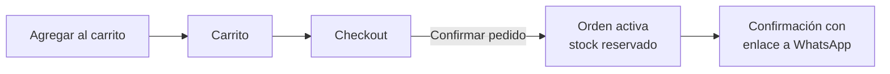
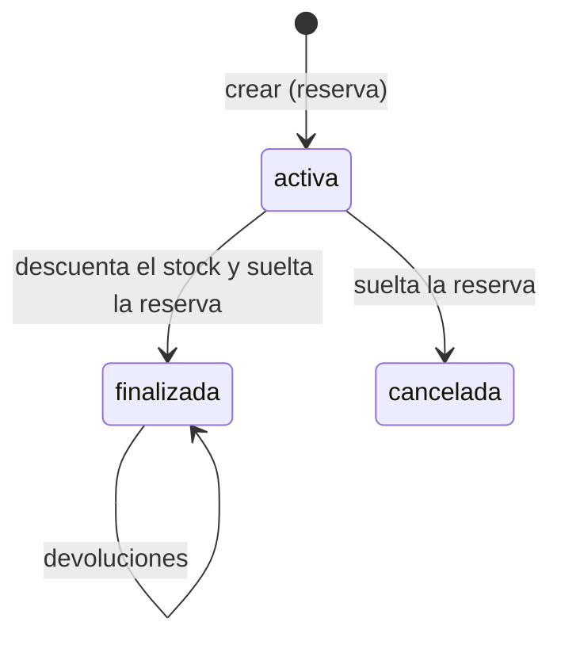

# Funcionamiento

Los recorridos importantes de AnaVende, paso a paso, con el archivo donde
vive cada uno. Para ver cómo están armadas las piezas que usan, leé
[Arquitectura](ARQUITECTURA.md). Las reglas completas están en la
[especificación funcional](../sdd/mvp/FUNCTIONAL-SPEC.md) (RF y RN) y en la
[técnica](../sdd/mvp/TECHNICAL-SPEC.md) (TS).

## La idea de fondo

La web no cobra. Arma el pedido, aparta el stock y termina en una
conversación de WhatsApp con Ana, que ya trae el producto, el color, la
cantidad y el precio. El pago y la entrega se arreglan en esa conversación,
fuera del sistema. Lo que el sistema garantiza es que **el stock diga la
verdad**, incluidas las ventas que no pasaron por la web.

## Mirar y consultar, sin cuenta

Un visitante navega todo: la home, el catálogo con filtros y búsqueda, las
categorías y la ficha de cada producto.

- **El catálogo** (`/productos`) guarda todo su estado en la dirección:
  filtros, orden y página. El botón atrás funciona, y el enlace se puede
  mandar por WhatsApp tal como se está viendo (`modules/catalog/products/tienda.ts`).
  Los filtros se abren en un drawer a la derecha, y en el teléfono a
  pantalla completa (`components/shop/filtros-catalogo.tsx`). Cada grupo
  muestra sus 8 opciones con más productos y un «Ver las N» para el resto,
  con buscador cuando son más de 12 (`components/shop/grupo-de-filtro.tsx`).
  Las opciones se ajustan a lo elegido: cada grupo ofrece solo lo que tiene
  productos con los filtros de los otros grupos, y lo ya elegido sigue a la
  vista para poder sacarlo (`leerOpcionesDeFiltro`). La casilla de ofertas
  también: si no hay nada en oferta con lo elegido, no aparece.
- **Cada categoría tiene su página** (`/categorias/[slug]`): es el mismo
  catálogo con la categoría fija (`components/shop/vista-del-catalogo.tsx`),
  con su texto opcional cargado desde el panel. Sin filtros se indexa y va
  en `sitemap.xml`; con filtros, no. La home, `/categorias`, la ficha y los
  recomendados llevan ahí. En el drawer, elegir otra categoría la suma y
  lleva a `/productos` con las dos y el resto de los filtros; destildar la
  de la página lleva a `/productos` con el resto. Una categoría desactivada
  da 404.
- **La ficha** (`/productos/[slug]`) cambia de foto, stock y mensaje al
  elegir otro color, sin recargar. Si el producto tiene SKU, va entre el
  nombre y el precio con un botón para copiarlo
  (`components/shop/ficha/sku.tsx`); un producto sin color muestra
  «Color: Único». El slug no cambia al renombrar un
  producto, para no romper los enlaces ya compartidos. Si la descripción
  pasa de unos doce renglones, se ven los primeros ocho y un «Mostrar más»
  (`components/shop/ficha/descripcion-plegable.tsx`). El texto completo
  viene igual desde el servidor: solo se recorta.
- **«Consultar por WhatsApp»** arma un enlace `wa.me` con el producto, el
  color y la cantidad que se están mirando (`lib/whatsapp.ts`). Es la forma
  de comprar sin cuenta.
- **Los recomendados** de la ficha y del carrito los calcula el servidor
  (`modules/catalog/products/recomendados.ts`) y llegan después que el resto
  de la página, para no demorarla. «Vistos recientemente» lo anota el
  navegador en una cookie.

Un visitante **no arma carrito**: el carrito es de las cuentas.

## Comprar

1. **Agregar al carrito.** Si quien aprieta no tiene sesión, la compra queda
   en una cookie mientras se registra o ingresa, y se completa al volver
   (`modules/cart/pendiente.ts`). Es una cookie y no un parámetro en la
   dirección para que nadie pueda mandar un enlace que le agregue cosas al
   carrito de otro.
2. **El carrito no reserva stock.** Se guarda en la base y dura entre
   visitas. Al abrirlo se lo compara con el catálogo
   (`modules/cart/revision.ts`): si un precio cambió, queda el nuevo y se
   avisa una vez; si queda menos stock que lo pedido, la cantidad baja y se
   avisa; si no queda nada, el renglón se marca y sale del total, sin
   borrarse.
3. **El checkout** (`app/(shop)/checkout/`) pide los datos, la forma de
   entrega y muestra los medios de pago. La entrega es **envío**, con
   dirección, o **retiro**, sin ella; no hay columna para eso: se deduce de
   la dirección (`modules/orders/entrega.ts`). Para confirmar hace falta el
   email verificado y el perfil completo.
4. **Confirmar el pedido** crea la orden en una sola transacción
   (`modules/orders/crear.ts`, TS §8.4): relee el carrito y el catálogo; si
   algo cambió respecto de lo que el comprador vio, frena y le pide
   reconfirmar; si no, guarda la orden con una foto de los precios y los
   datos, **reserva el stock** de cada renglón y vacía el carrito.
5. **Un doble clic no crea dos órdenes.** El checkout genera una clave de
   idempotencia cada vez que se abre, y un índice único en la base la hace
   cumplir (TS §8.5).
6. **Después de guardar**, la tienda le avisa a Ana por email (E4). Si el
   email falla, la orden queda igual y el fallo va a Sentry.
7. **La confirmación** (`/orden/[numero]`) muestra el pedido y un botón de
   WhatsApp con el mensaje ya escrito. Solo la ve quien la hizo.

**Las guías de uso** (RF-36) explican este camino la primera vez que alguien
pasa por la ficha, el checkout, «Mis compras» y el detalle de un pedido en
preparación: un globo que resalta cada parte, hecho con Driver.js
(`components/ui/ayuda-guiada.tsx`). Lo visto se anota en el navegador, no
en la base, así que vale igual con o sin cuenta. «Ayuda» la vuelve a
abrir; en la ficha es solo el ícono, a la derecha de las migas. Los pasos señalan elementos con `data-ayuda`: si se renombra uno, su
paso deja de aparecer.

## Lo que hace Ana con una orden

- **Editar una orden activa** (`modules/orders/editar.ts`), para que coincida
  con lo que se terminó acordando por WhatsApp. Quitar o reducir siempre se
  puede y libera la reserva. Sumar o agregar puede no poderse: hay que
  reservar, y si el stock no está, se niega y se dice cuánto hay.
- **Finalizar** cuando se entregó y se cobró: descuenta del stock total.
  **Cancelar** si no se concretó: libera lo reservado. Las dos son finales.
  Dos clics simultáneos dan un ganador y un error, nunca un doble descuento
  (`modules/orders/estados.ts`).
- **Cargar una orden manual** (`modules/orders/manual.ts`) para una venta que
  no pasó por la web, por WhatsApp o en persona. El precio lo pone Ana. Puede
  cargarse finalizada, y entonces descuenta directo; si eso deja el stock en
  negativo, se permite, porque la venta ya ocurrió, y el panel lo destaca
  como una diferencia a revisar.

**El panel también tiene guías de uso** (RF-37): en el detalle de una orden
activa, la orden manual, la edición de un producto y devoluciones, que son
las pantallas donde una acción mueve el stock o no tiene vuelta atrás. Es el
mismo componente que en la tienda, con la escala y el modo oscuro del panel.
Lo visto también se anota en el navegador, así que en otro dispositivo la
guía se ve una vez más.

## Devoluciones

Se registran contra una orden **finalizada**: lo que no se entregó se edita o
se cancela (`modules/returns/registrar.ts`).

- Cada renglón dice si **repone** (el producto vuelve al stock) o **no
  repone** (estaba fallado: se registra y no toca el stock).
- No se puede devolver más de lo que se vendió.
- Una devolución no se edita: **se anula** y se vuelve a cargar. Anularla
  revierte lo que había repuesto.
- Las devoluciones restan de las ventas en los reportes, el día en que se
  registraron.

## Cargar un producto

1. **Alta del producto** en el panel: nombre, marca, categoría, precio,
   descuento y descripción con formato
   (`modules/catalog/products/actions.ts`). La descripción se escribe con
   los botones del editor; pegar texto con formato lo conserva, y pegar
   Markdown escrito como texto (`**negrita**`, `- ` para viñetas) lo
   convierte (`components/admin/productos/formato.ts`). Si la marca o la
   categoría todavía no existen, se crean desde el mismo selector, sin salir
   del producto.
2. **Variantes de color**, cada una con su stock
   (`modules/catalog/variants/actions.ts`). Cambiar el stock desde acá es un
   **ajuste** que queda asentado en el libro mayor como cualquier otro
   movimiento. Un color que no está en el catálogo se crea ahí mismo. Con
   más de tres colores, cada uno se pliega: cerrado muestra nombre, stock y
   estado, y se abre de a uno, con sus fotos y sus botones. Arranca abierto
   el primero. «Único» es la variante sin color, para lo que no se elige
   por color: no aparece al filtrar por color. Si en la categoría la mayoría
   de los productos tiene color, el panel avisa
   (`categoriaQueSeVendePorColor`).
3. **Fotos de cada color.** Se suben por `/api/admin/upload`, se convierten
   en el momento y el original no se guarda (ver
   [Arquitectura](ARQUITECTURA.md#fotos)). Una variante puede reutilizar las
   fotos de otra del mismo producto. Tocar una miniatura, o «Ver más grande»
   en su menú, la abre en el mismo visor de la ficha
   (`components/ui/visor-de-fotos.tsx`), con las fotos de ese color y el
   zoom sobre la versión `detail`. Arriba de los colores se ve si la
   **marca de agua** está activada o desactivada, con un enlace a donde se
   arma; avisa y no frena la subida (abajo).
4. **Activarlo.** No se puede activar un producto con la marca, la categoría
   o un color desactivados, y no se puede desactivar una marca, una
   categoría o un color mientras haya un producto activo que lo use. Así,
   `products.is_active` es lo único que decide si un producto se ve. Ya
   activo, «Ver en la tienda» abre su ficha en otra pestaña y «Copiar
   enlace» copia la dirección. Inactivo no ofrece ninguno de los dos: la
   ficha da 404 también para quien administra.

**La marca de agua** (RF-39, F2.16) se arma en
`/admin/configuracion/marca-de-agua`, enlazada desde Configuración. Sin
imágenes, la pantalla es solo «subí tu marca». Con imágenes se parte en dos
mitades: a la izquierda se arma y a la derecha se mira, y el estado con su
botón va en el encabezado. La **biblioteca** guarda imágenes PNG o WEBP con fondo
transparente hasta que se borran a mano. Las **capas**, hasta cuatro, eligen
cada una una imagen, una forma (en un lugar, repetida, cubrir o estirar), un
tamaño y una opacidad, y se guardan juntas. Con dos o más se pliegan y se
abre una por vez, como los colores del producto: cerrada, cada una muestra su
imagen, su número y un resumen de dónde va. La **vista previa** prueba las
capas en pantalla, todavía sin guardar. Arranca con la última foto de
producto que se subió sin marca, y se puede cambiar por una del equipo, que
no se guarda. El interruptor la activa solo con capas guardadas y sin cambios
pendientes. Mientras está activa, cada foto de producto que se sube la lleva
en `card` y `detail` (la miniatura queda limpia) y queda anotada en
`variant_images.has_watermark`. Las fotos que ya estaban no cambian nunca:
para sacarle la marca a una foto se desactiva, se vuelve a subir y se
reactiva. Borrar la imagen de la única capa la desactiva sola.

**Borrar puede terminar en desactivar:** un producto o una variante que
alguna orden nombra no se borra, porque la orden lo sigue mostrando. Se
desactiva y se avisa. Una variante con stock reservado no se puede quitar.

## Cuentas

- **Alta** (`/registro`): Turnstile para frenar robots, y un email para
  confirmar la dirección. Hasta confirmarla, la persona puede navegar pero
  no hacer pedidos. Una identidad sin perfil completo lo termina en
  `/completar-perfil` antes de poder comprar.
- **Con Google** (`/ingresar` y `/registro`): el mismo botón crea la cuenta o
  entra, y vuelve por `/api/auth/callback`. La primera vez pasa por
  `/completar-perfil`, porque Google no da el teléfono; el nombre y el
  apellido llegan precargados, por separado, como los tiene en Google. Si ya había una cuenta
  con ese email, se vinculan solo si el email estaba confirmado. El botón
  aparece solo si GoTrue tiene Google prendido; Facebook, igual, cuando se
  configure.
- **Cuentas sin confirmar:** a las 48 horas se borran solas, con una tarea
  programada (`scripts/limpiar-cuentas.mjs`), para que nadie deje tomado el
  email de otra persona. No se borran las que invitó Ana desde el panel ni
  las que tienen órdenes.
- **Bloquear** (panel, «Usuarios»): corta todo en el momento. Las acciones se
  rechazan porque releen el perfil, y las pantallas cierran la sesión aunque
  el token todavía sea válido (`modules/users/acceso.ts`).
- **Foto de perfil** (`/mi-cuenta`, «Mis datos»): opcional, y no se pide en
  el alta. Se guarda al elegirla, por `/api/mi-cuenta/foto`, como una sola
  versión cuadrada de 256px (`modules/media/subir.ts`); cambiarla o quitarla
  borra el archivo anterior. Sin foto, la cuenta se ve con un **blobatar**
  sacado de su id, siempre el mismo (`modules/users/avatar.ts`). **Quien se
  da de alta con Google** empieza con su foto de Google, bajada y procesada
  como una subida al completar el perfil (`modules/users/datos-de-google.ts`);
  si no eligió ninguna en Google, o algo falla, con su blobatar. Se ve en
  «Mi cuenta», en el encabezado, en el menú del panel y en «Usuarios», y no
  la ve ningún otro comprador.
- **Pedir la baja** (`/mi-cuenta/baja`): la cuenta pasa a solo lectura, y el
  comprador puede retirar el pedido mientras no se haya ejecutado. La
  ejecuta Ana desde el panel, y **ejecutarla borra la foto de perfil**:
  revertirla no la trae.
- **Administradoras:** se suman invitándolas desde el panel. El panel no deja
  quitarle el rol a la última, ni que una se lo quite a sí misma.

## Reportes y el inicio del panel

Una **venta** es una orden finalizada y cuenta el día en que se finalizó; las
devoluciones restan el día en que se registraron (`modules/reports/queries.ts`).
El inicio del panel y los reportes usan esa misma definición, así que «este
mes» da lo mismo en los dos. Los reportes se exportan a Excel desde
`/admin/reportes`.

## Fechas especiales

En **Pascua** (la Semana Santa, del Domingo de Ramos al de Pascua),
**Halloween** (1 de octubre al 1 de noviembre) y **Navidad** (1 de diciembre
al 7 de enero) la tienda se decora sola: el hero de la home cambia sus dibujos
y el logo de la barra lleva un adorno. Los períodos están en `lib/escenas.ts`
y se cuentan con la fecha de Argentina; Pascua se calcula para cada año; las piezas de cada
escena, en `components/shop/home/escena-del-hero.ts`. Cada fecha se apaga
desde «Configuración» → «Fechas especiales».

## Tienda cerrada

Con el **modo mantenimiento** prendido desde «Configuración», el público ve
una página de mantenimiento, con un 503 para que los buscadores no la
indexen, y quien administra ve la tienda normal, para revisar cada ficha
como la va a ver un comprador (`modules/settings/mantenimiento.ts`).

**Mientras está cerrada, solo entran las administradoras, y no se crean
cuentas.** `/registro` responde 503 como el resto. En `/ingresar`, una
compradora con la contraseña correcta recibe «El sitio está en
mantenimiento…», sin decir quién sí entra, y no queda con la sesión
abierta. Con Google, la vuelta cierra la sesión y
manda a `/mantenimiento`, y si la cuenta la acababa de crear GoTrue, la
borra (`app/api/auth/callback/route.ts`).
