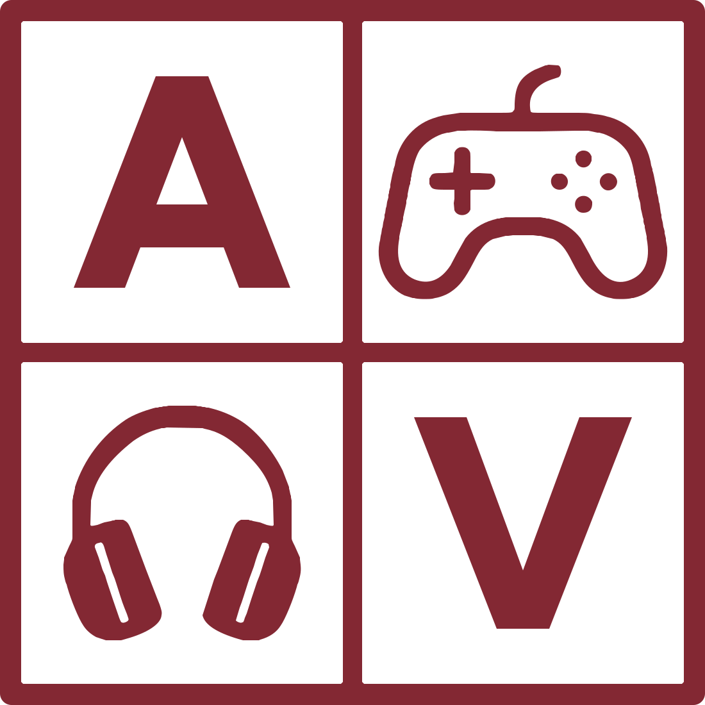

# Marca

Cómo es el logo de AnaVende, qué versiones tiene, dónde va cada una y cómo se
regeneran los archivos. Las reglas de uso están en DESIGN-REFERENCE §2.3; acá
está lo que hace falta para aplicarlas.

<p>
  
  &nbsp;&nbsp;
  
</p>

## Las versiones

| Versión | Qué es | Dónde va |
|---|---|---|
| **Isotipo** | La cuadrícula: A, joystick, auriculares y V | Encabezado en el teléfono, favicon, imagen para compartir, datos para Google |
| **Horizontal** | Isotipo + «AnaVende» | Encabezado en la computadora, ingreso, mantenimiento, pie, panel, correos |
| **Palabra** | «AnaVende» sola, grande | El hero de la home, y nada más |
| **Clara** | Cualquiera de las dos, en blanco | Sobre fondo oscuro: el pie de la tienda y el panel en modo oscuro |

El color es uno solo: burdeos `#832833`, el `--brand` de la tienda. En
oscuro, blanco. Nada más: no hay versión en gris, en negro ni en degradé.

## La animación de la primera carga

La primera vez que alguien abre la home en una visita, el «AnaVende» grande
del hero arranca siendo el isotipo: el marco, el joystick y los auriculares se
apagan, la A y la V crecen hasta su lugar en la palabra, y de cada una sale el
resto, «na» y «ende». Dura 2,9 segundos: el isotipo queda quieto 0,8 segundos para que se reconozca antes de abrirse.

- **Una vez por visita.** Se anota en `sessionStorage` y en el atributo
  `data-marca-vista` de `<html>`. Volver al inicio desde otra página o
  recargar no la repite; una pestaña nueva sí la muestra. Si alguien se va
  antes de que termine, al volver la ve entera.
- **Quieta con «reducir movimiento».** Se ve directamente la palabra.
- **Es CSS.** Arranca con el primer pintado, sin esperar a React. Lo que se ve
  quieto es el estado final; la animación lo recorre desde la grilla.
- **Dónde está:** `components/shop/home/marca-del-hero.tsx` (las piezas y de
  dónde sale cada letra), las reglas `marca-del-hero-*` en `app/globals.css` y
  el script de `app/layout.tsx` que evita repetirla al recargar.

## Las medidas

El isotipo es una caja cuadrada de 1100 unidades:

| Pieza | Medida |
|---|---|
| Borde de afuera | 33, con esquinas de radio 18 |
| División entre celdas | 30 |
| Celdas | 502 × 502, esquinas de radio 3 |
| A y V | Figtree ExtraBold (800), alto de mayúscula 330, centradas en su celda |
| Joystick y auriculares | Centrados en su celda por su caja, simétricos |

La horizontal suma la palabra a la derecha:

| | Proporción del lado del isotipo | A 32px |
|---|---|---|
| Alto de mayúscula de la palabra | 45 % | 14,4px |
| Separación entre isotipo y palabra | 30 % | 9,6px |

La palabra va centrada en el alto del isotipo, en el mismo color. El tamaño de
uso es 32px de isotipo, y nunca menos de 24px salvo en el favicon (a 16px las
celdas se funden).

## La letra

La A, la V y la palabra son de **Figtree ExtraBold**, de Google Fonts
(licencia OFL). Se eligió midiendo: se superpusieron la A y la V del logo
original con las de 50 fuentes en cuatro grosores, al mismo alto, y Figtree
800 coincide en un 90,7 % con la A plana arriba, como la original. Las
descartadas y por qué están en la fila de F10.7c en `PROGRESO.md`.

**Figtree es la letra del logo, no la de la interfaz.** Los textos de la
tienda y el panel siguen en Inter (DESIGN-REFERENCE §1.2). La palabra va
convertida en trazo, así que no se carga ninguna fuente para dibujarla.

## Dónde vive

- **`lib/marca.ts`** — la fuente de verdad: un trazo SVG por pieza (marco, A,
  joystick, auriculares, V), la palabra y las proporciones de la horizontal.
  Cada pieza va aparte para poder moverla sola, y la palabra va en cuatro
  partes —«A», «na», «V», «ende»— por lo mismo.
- **`components/shop/logo.tsx`** — `Isotipo`, `LogoHorizontal` y `Logo` (el
  del encabezado, con enlace). Dibujan los trazos en línea con el color del
  token `--logo`, que cambia solo con el tema del panel; `claro` lo pide
  blanco sobre el pie.
- **`public/marca/`** y **`app/favicon.ico`** — los archivos para lo que no
  puede dibujar un componente:

  | Archivo | Para qué |
  |---|---|
  | `isotipo.svg` | El isotipo suelto, para quien lo pida |
  | `logo.png` | 512 × 512, el logo de los datos estructurados (Google) |
  | `logo-horizontal.png` | La horizontal a 80px de alto, para los correos |
  | `og.png` | La vista previa al compartir un enlace: isotipo blanco sobre burdeos |
  | `app/favicon.ico` | La pestaña: 16, 32 y 48px |

## Cómo se regeneran los archivos

Si cambia algo en `lib/marca.ts`, en este orden:

```sh
npx tsx scripts/derivar-logo.mts   # isotipo.svg, logo.png, logo-horizontal.png, favicon.ico
npx tsx scripts/derivar-og.mts     # og.png
npm run email                      # las plantillas de correo de public/emails/
```

## Cómo se construyó

El logo original llegó como un PNG de 1180 × 1128. En noviembre de 2026
(F10.7c) se redibujó sobre el mismo dibujo para tener una versión horizontal
y para que todo encaje:

1. **El marco** se trazó de nuevo con las medidas de arriba, en caja cuadrada.
2. **La A y la V** se reemplazaron por las de Figtree ExtraBold, al mismo alto
   que las originales.
3. **El joystick y los auriculares** se vectorizaron del original y se
   volvieron simétricos: la mitad derecha es el espejo de la izquierda, salvo
   el cable y los cuatro botones del joystick, que quedan como estaban.
4. Los trazos se simplificaron a coordenadas enteras: el isotipo entero pesa
   unos 3 KB.

Al lado del original, a 32px, la diferencia no se nota: es el mismo logo más
prolijo.
