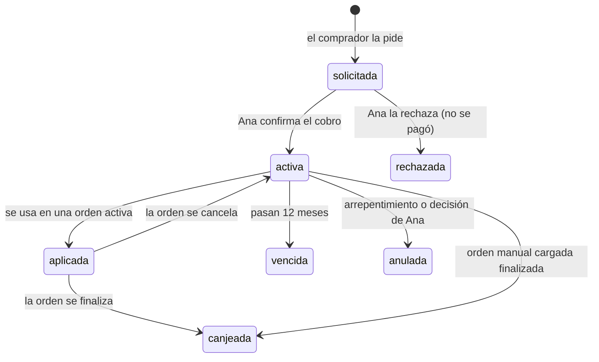

# Gift card — definición

> **Estado:** definida el 2026-10-22, **sin fecha de implementación**. Es
> posterior al MVP: está en el backlog de `DEVELOPMENT-PLAN.md` §6. Cuando se
> tome, esta definición se baja a RF, RN y tareas en las especificaciones de
> `sdd/mvp/` (o en las de la fase que corresponda), y lo que se decida distinto
> se anota en el historial de decisiones.

## 1. Qué es y qué no es

Una gift card es **dinero ya pagado** que se canjea por productos de la tienda.
**No es un descuento** ni un cupón (FA-09):

- **Paga el precio final.** Si el producto está en oferta (RN-04b), la tarjeta
  paga el precio con descuento. No hay descuento sobre descuento.
- **La orden no cambia de precio.** Los renglones siguen congelados (RN-12) y
  el total es el mismo. Lo que se suma es **cómo se paga**: «pagado con gift
  card» y «resta pagar».
- **No es venta de producto.** En los reportes (RF-28), la venta de una gift
  card y la de lo que se compra con ella no pueden contarse dos veces.

**La web sigue sin cobrar** (RN-01, FA-01). El pago de la tarjeta se coordina
fuera del sistema, igual que el de una orden, y **Ana la activa a mano** cuando
confirma el cobro.

## 2. Reglas

| # | Regla |
|---|---|
| **GC-01** | **Montos fijos:** $ 5.000, $ 10.000, $ 20.000 y $ 50.000. No hay monto libre. |
| **GC-02** | **Para comprarla hace falta cuenta** (con email verificado, como para confirmar una orden). **Para canjearla no.** |
| **GC-03** | **Se usa en una sola compra.** No se parte en varias. |
| **GC-04** | Si la compra cuesta **más** que la tarjeta, se paga la diferencia por los medios habituales. Si cuesta **menos**, **el sobrante se pierde** y no se devuelve. |
| **GC-05** | **Una gift card por compra.** No se combinan varias en la misma orden. |
| **GC-06** | **Vence a los 12 meses** de su activación. La fecha exacta se informa en la landing antes de pedirla, en el email y en la consulta de saldo. |
| **GC-07** | **Arrepentimiento:** una tarjeta **sin usar** se devuelve si se pide dentro de los **10 días** de recibida (Ley 24.240 art. 34; CCyC art. 1110). Se anula y Ana devuelve el dinero fuera del sistema. Igual que con las órdenes (RF-23), pedir el arrepentimiento no exige motivo. |
| **GC-08** | **Devolución de un producto** pagado con gift card: es una devolución como cualquier otra (RF-25) y **se registra contra la orden donde se usó la tarjeta**. La tarjeta no se reactiva ni se emite otra. La política de devoluciones de Legales (RF-29) se amplía para decirlo. |
| **GC-11** | **Factura, sólo si el comprador la pide.** Al pedir la gift card puede marcar «Quiero factura»; Ana la emite fuera del sistema (factura C). |
| **GC-09** | **Todas las condiciones se leen antes de pedirla**, en la landing y a la vista, no en letra chica ni detrás de un enlace: montos, vencimiento, un solo uso, sobrante sin devolución, arrepentimiento y cómo se canjea. |
| **GC-10** | Una tarjeta **no se borra nunca** (como RN-11): se anula, con motivo, y queda en el historial. |

## 3. Estados

- **`solicitada`** todavía no tiene código: el código se genera **al activar**,
  para que nunca exista un código válido de una tarjeta impaga.
- **`aplicada`** es la reserva: la tarjeta queda tomada por una orden activa y
  no se puede usar en otra. Es el mismo mecanismo que la reserva de stock.
- **El vencimiento corre sobre `activa`.** Una tarjeta `aplicada` a una orden
  que se cancela después del vencimiento vuelve como `vencida`, no como
  `activa`.

## 4. Recorridos

### Comprar una gift card

1. **Landing `/gift-card`.** Presenta la tarjeta, los cuatro montos y las
   condiciones (GC-09). Se llega desde un **bloque en la home** y desde el pie.
   La landing la ve cualquiera; **pedirla** exige sesión, con el mismo
   mecanismo que «Agregar al carrito» sin sesión (`modules/cart/pendiente.ts`):
   el pedido espera mientras la persona ingresa o se registra.
2. **El pedido.** El comprador elige el monto y, de forma opcional, escribe
   para quién es y un mensaje, y marca si quiere factura (GC-11). Confirma
   que leyó las condiciones. La tarjeta queda `solicitada`.
3. **Aviso a Ana** por email (como E4): quién la pidió, el monto y el enlace al
   panel. El comprador ve una confirmación con un botón de WhatsApp para
   coordinar el pago, igual que en la confirmación de una orden.
4. **Ana confirma el cobro** en el panel. La tarjeta pasa a `activa`, se
   genera el código y empieza a correr el vencimiento.
5. **Email al comprador** con el código, el monto, el vencimiento, las
   condiciones resumidas y un botón **«Enviar por WhatsApp»**: un enlace
   `wa.me` sin destinatario, con el mensaje armado para regalarla (código,
   monto, vencimiento y cómo canjearla).
6. **«Mis gift cards»** en la cuenta del comprador: las que pidió, en qué
   estado está cada una y, si está activa, el código y el botón de WhatsApp de
   nuevo. Desde ahí se pide el **arrepentimiento** (GC-07) mientras esté en
   plazo y sin usar.

### Canjear una gift card

- **Con cuenta, en el checkout.** Un campo «¿Tenés una gift card?» valida el
  código, muestra el monto y recalcula el «resta pagar». Si la tarjeta cubre
  más que la compra, avisa **antes de confirmar** que el sobrante se pierde
  (GC-04). Al confirmar el pedido, la tarjeta pasa a `aplicada` **en la misma
  transacción** que crea la orden y reserva el stock (`modules/orders/crear.ts`).
- **Sin cuenta, por WhatsApp.** Quien recibió la tarjeta le escribe a Ana con el
  código. Ana carga una **orden manual** (RF-24) y aplica ahí la tarjeta.
- **Ana también puede aplicarla a una orden activa** desde el detalle de la
  orden, por ejemplo cuando el comprador se olvidó de ponerla en el checkout.

**Consulta de saldo** pública (`/gift-card/consultar`): con el código se ve si
está activa, el monto y hasta cuándo vale. No muestra quién la compró ni a
quién va.

### Lo que hace Ana

- **Listado de gift cards** con filtros por estado y búsqueda por código o
  comprador. Las `solicitadas` aparecen en el dashboard (RF-14) como pendientes.
- **Confirmar cobro** (→ `activa`) o **rechazar** (→ `rechazada`, con motivo).
- **Anular** una activa, con motivo (arrepentimiento u otro).
- **Reenviar** el email con el código.
- **Ver el historial** de cada tarjeta: quién la pidió, quién la activó y en
  qué orden se usó.

## 5. Interacción con lo que ya existe

| Pieza | Qué cambia |
|---|---|
| **Cancelar una orden** (RF-23) | La tarjeta vuelve a `activa` (o a `vencida`, si ya pasó la fecha). |
| **Editar una orden activa** (RF-22, F4.4) | Si el total baja por debajo del monto de la tarjeta, el sobrante se pierde (GC-04). El diálogo de Ana lo **advierte** antes de quitar el renglón. Quitar el último renglón cancela la orden y devuelve la tarjeta. |
| **Finalizar una orden** | La tarjeta pasa a `canjeada`. |
| **Idempotencia del checkout** (TS §8.5) | Un doble clic no puede aplicar la misma tarjeta dos veces. |
| **Mensaje de WhatsApp y email E4** | Dicen el código usado, cuánto cubre y cuánto resta pagar. |
| **Detalle de la orden** (comprador y panel) | Total, «pagado con gift card» y «resta pagar». Se mantiene RN-04c: no se agrega «ahorrás». |
| **Reportes** (RF-28) | Las gift cards vendidas van en una línea aparte. Las ventas de producto se siguen contando por su total; no se suma dos veces el mismo dinero. |
| **Baja de cuenta** (RF-34) | Una baja no anula las gift cards ya activas: el código sigue valiendo para quien lo tenga. Una `solicitada` sin cobrar se rechaza. |
| **Legales** (RF-29) | Suma una sección con las condiciones de la gift card, y la política de devoluciones aclara qué pasa con lo pagado con una (GC-08). |
| **Emails** (RF-30) | Suma dos: aviso a Ana de una gift card pedida, y **el primer email transaccional al comprador** fuera de la cuenta (el código). FA-06 sigue valiendo para las órdenes. |

## 6. Notas técnicas

- **Datos.** Una tabla `gift_cards` (monto, estado, código, comprador,
  destinatario y mensaje opcionales, fechas de pedido, activación y
  vencimiento, quién la activó) y un **historial de movimientos** (pedida,
  activada, rechazada, aplicada a la orden N, devuelta por cancelación,
  canjeada, vencida, anulada con motivo), con el mismo criterio de libro
  mayor que el stock (TS §5.8). La orden guarda la tarjeta aplicada y el monto
  que cubrió.
- **Monto que cubre:** `min(monto de la tarjeta, total de la orden)`, calculado
  en la base, no en JavaScript (como `final_price`, TS §5.4).
- **Concurrencia.** Aplicar una tarjeta bloquea su fila (`SELECT … FOR
  UPDATE`) dentro de la transacción de la orden. Dos órdenes simultáneas con
  el mismo código: una gana y la otra recibe «esta gift card ya se usó».
- **El código:**
  - Aleatorio, de un generador criptográfico, **nunca correlativo**.
  - Legible para dictar: por ejemplo `ANA-7K3P-Q9XM`, sin caracteres que se
    confunden (0/O, 1/I/L).
  - Se compara sin distinguir mayúsculas ni guiones.
  - Índice único en la base.
- **Fuerza bruta.** La validación en el checkout y la consulta de saldo
  **limitan los intentos** por IP y por cuenta. El mensaje de error es el
  mismo para un código inexistente y para uno vencido o usado, para que no
  sirva para adivinar.
- **El código no se filtra:**
  - No va en direcciones que quedan en el historial (la consulta de saldo es
    un formulario POST, no `?codigo=`).
  - No se registra en logs ni en Sentry.
  - En el panel se muestra completo solo en el detalle de la tarjeta.
- **Vencimiento sin tareas programadas.** No hay cron en el stack. El estado
  `vencida` se deduce de la fecha al leer, y se asienta en el historial la
  primera vez que alguien intenta usarla.
- **Imagen para compartir.** El email y la confirmación pueden llevar una
  imagen de la tarjeta (monto y diseño, **sin el código** si la imagen se
  guarda en un lugar público).
- **Pantallas nuevas** (landing, consulta, «Mis gift cards» y las del panel):
  pasan por las skills de diseño, la lista de accesibilidad de `DESIGN.md` y
  se suman a `PANTALLAS` en `tests/e2e/accesibilidad.spec.ts`.
- **Documentación:** `docs/FUNCIONAMIENTO.md` suma el recorrido.

## 7. Lo legal

Investigado el 2026-10-22. **No se encontró una norma argentina específica
sobre gift cards**, ni nacional ni provincial; aplica el marco general de
defensa del consumidor. **Antes de publicar, un abogado lee los términos.**

- **Información previa y clara** (Ley 24.240, art. 4): las condiciones tienen
  que estar a la vista antes de pedirla (GC-09).
- **Vencimiento:** no hay un mínimo legal. Lo habitual en el mercado es entre
  3 y 12 meses (BBVA), o 12 meses (Cencosud, Falabella). Un plazo corto es lo
  que más reclamos genera.
- **Arrepentimiento:** la venta a distancia da 10 días para revocar (Ley
  24.240 art. 34; CCyC art. 1110), y limitarlo es cláusula abusiva
  (Disposición 377/2026, inc. n). De ahí sale GC-07.
- **Sobrante sin devolución:** no está prohibido, pero una cláusula que
  «desnaturaliza» el contrato se tiene por no escrita (art. 37). Informarlo de
  forma destacada es lo que la sostiene.
- **Facturación:** Ana es monotributista y emite factura C. Se decidió
  ofrecerla sólo a quien la pida (GC-11); conviene confirmar con su contador
  que eso alcanza para sus obligaciones con ARCA.

## 8. Decisiones

| Fecha | Decisión |
|---|---|
| 2026-10-22 | Vencimiento de **12 meses** desde la activación (GC-06). Se había hablado de 90 a 180 días, pero ninguna norma lo fija y 12 meses es lo habitual. |
| 2026-10-22 | **Una gift card por compra** (GC-05). |
| 2026-10-22 | **Factura sólo si el comprador la pide** (GC-11). |
| 2026-10-22 | Un producto pagado con gift card se devuelve **como cualquier otro, contra su orden** (GC-08); Legales se amplía para decirlo. |
| 2026-10-22 | **El diseño de la tarjeta** (landing, email, imagen para compartir) se resuelve al implementar, sin referencias previas: con las skills de diseño y dentro de `DESIGN.md`. |

## 9. Fuentes

- [Tarjeta Regalo – BBVA](https://www.bbva.com.ar/empresas/productos/tarjetas/regalo.html)
  y [términos](https://www.bbva.com.ar/personas/avisos/terms-gift-card.html)
- [Términos y condiciones – Cencosud Venta Empresas](https://ventaempresas.cencosud.com.ar/?p=139)
- [Términos y condiciones – Mi Gift Card](https://migiftcard.ar/terminos.php)
- [Gift card de Falabella vencida antes de tiempo](https://tuquejasuma.com/falabella/reclamos/gift-card-de-falabella-vencida-antes-de-tiempo)
- [Cláusulas abusivas: Disposición 377/2026](https://noetingeryarmando.com/actualizacion-del-regimen-de-clausulas-abusivas-para-contratos-de-consumo-en-argentina/)
- [Ley 24.240 – Defensoría](https://navegador.defensoria.org.ar/normativas/ley-24240-de-defensa-del-consumidor/)
